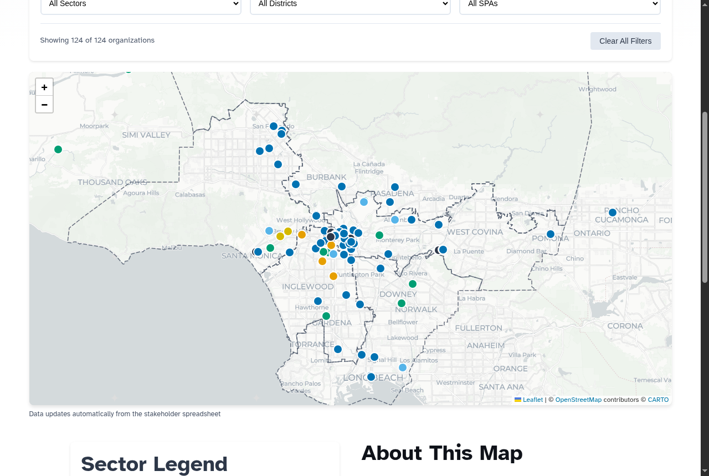

# LA Food Systems Map



An interactive map and survey dashboard of the organizations that make up Los Angeles County's food
system, for the LA County Office of Food Systems. Live at https://lacofsfoodsystemmap.lross.workers.dev.

The data comes from the stakeholder Google Sheet: responses to the Food Systems Stakeholder Survey (a
Google Form) plus organizations added by hand, such as farms and organizations from Kumu. The site reads
the sheet live, so edits show up within about 5–10 minutes without a developer.

**Maintaining the spreadsheet?** Read [docs/UPDATING-THE-MAP.md](docs/UPDATING-THE-MAP.md).

## Pages

| Path                | What it is                                                                                  |
| :------------------ | :------------------------------------------------------------------------------------------ |
| `/`                 | The map: one dot per organization, colored by sector, with search, filters and a Sector Legend |
| `/dashboard-simple` | Survey dashboard (survey respondents only)                                                  |
| `/data-check`       | What needs fixing in the sheet, by row number, for the sheet maintainer. Not linked; `noindex` |
| `/api/survey-data`  | The organizations as JSON                                                                   |
| `/failed`           | Old page; redirects to `/data-check`                                                        |

Every page renders on demand in the Cloudflare Worker (`export const prerender = false`).

## How the data flows

1. **Read the sheet.** `loadData()` (`src/lib/data.server.js`) fetches the sheet's published CSV
   (`src/config/googleSheets.js`). Cloudflare caches the response for 5 minutes and the Worker shares the
   result between requests for 60 seconds (requests that arrive during a read wait for it; pages pass
   `Astro.locals.runtime.ctx` so the read is finished with `waitUntil` even if its visitor leaves). Callers
   must not modify the result. If the sheet can't be read (error, timeout, no rows), it falls back to
   `src/data/snapshot.json` and the pages say they show a saved copy.
2. **Build the organizations.** `parseCSV` and `buildDataset` (`src/lib/organizations.js`, pure, runs in
   Node and in the Worker) turn the rows into organizations plus the report shown on `/data-check`:
   - columns are found by tolerant header matching (`src/lib/columns.js`), so "Website",
     "Contact (website address from Kumu)", "Latitude" and so on all work;
   - coordinates come from the sheet's `lat`/`lng` columns, else from `src/data/geocode-cache.json`;
   - the supervisorial district is the survey answer, else looked up from the coordinates
     (`src/data/districts.json`);
   - sectors are matched to the list in `src/lib/sectors.js`; anything else shows as Other;
   - rows with the same organization name (ignoring case and punctuation) are merged into one.
3. **Geocode offline.** Addresses are never geocoded on request. `npm run sync` (`scripts/sync.js`) looks up
   addresses that aren't in the cache yet and refreshes the snapshot. The nightly GitHub Action
   (`.github/workflows/refresh-data.yml`) runs it and commits any changes to `main`, which redeploys the site.

## Project structure

```text
.github/workflows/refresh-data.yml  nightly: npm test, npm run sync, commit changed data to main
docs/UPDATING-THE-MAP.md            guide for whoever maintains the spreadsheet
public/
  districts.geojson                 supervisorial district boundaries drawn on the map
  fonts/ images/ favicon.svg
scripts/
  sync.js                           npm run sync
src/
  components/                       BaseHead, Footer, MapContainer, SearchFilters, SectorLegend
  config/googleSheets.js            published CSV URL of the sheet
  consts.ts                         site title and description
  data/
    districts.json                  simplified district boundaries (same as public/districts.geojson)
    geocode-cache.json              address → [lat, lng], or null when not found (written by sync)
    snapshot.json                   saved copy of the sheet, without contact names, emails or comments (written by sync)
  lib/
    sectors.js                      sector list, dot colors and legend order
    columns.js                      tolerant header matching
    address.js                      address cleanup, geocode cache keys, lat/lng checks, website links
    districts.js                    district and SPA parsing, point-in-district lookup
    organizations.js                CSV → organizations + data-quality report
    data.server.js                  loadData(): the live sheet, falling back to the snapshot
    survey.js                       survey answer parsing and dashboard summaries
  pages/
    index.astro                     map
    dashboard-simple.astro          survey dashboard
    data-check.astro                data-quality report
    failed.astro                    redirect to /data-check
    api/survey-data.ts              JSON API
  styles/global.css
tests/
  *.test.js                         node:test suites
  fixtures/sheet.csv                copy of the real sheet (148 rows), names, emails and comments redacted
  fixtures/geocode-cache.json       the geocode cache as it was when sheet.csv was taken
```

## Commands

Use Node 22 (the version the nightly job uses). All commands run from the project root:

| Command                     | Action                                                                          |
| :-------------------------- | :------------------------------------------------------------------------------ |
| `npm install`               | Install dependencies                                                            |
| `npm run dev`               | Start the dev server at `localhost:4321` (reads the live sheet)                 |
| `npm test`                  | Run the tests (offline, against `tests/fixtures/sheet.csv`)                     |
| `npm run build`             | Build the Worker into `./dist/`                                                 |
| `npm run preview`           | Build, then run the Worker locally with `wrangler dev`                          |
| `npm run sync`              | Geocode new addresses and refresh the snapshot (see below)                      |
| `npm run check`             | Build, type-check and `wrangler deploy --dry-run`                               |
| `npm run deploy`            | Deploy with Wrangler (normally not needed: pushes to `main` deploy automatically) |
| `npm run cf-typegen`        | Regenerate `worker-configuration.d.ts`                                          |

## The sync script

```sh
npm run sync                                                       # read the sheet, geocode, write both files
npm run sync -- --dry-run                                          # report only: no lookups, no files written
SHEET_CSV_PATH=tests/fixtures/sheet.csv npm run sync -- --dry-run  # read a local CSV instead of the sheet
```

- It prints the same summary as `/data-check` (rows → duplicate rows merged → organizations → on the map +
  missing a location) and lists the rows that need attention.
- Each row's address that isn't in the cache yet is looked up (rows with usable `lat`/`lng` are skipped),
  using OpenStreetMap's Nominatim, at most one request per 1.1 s. A merged organization's older rows count
  too, and its latest row's address is looked up even when an older row already puts it on the map.
  Only results in California and in the row's zip code count; addresses without a street number
  ("Texas") aren't searched for. Addresses that weren't found are cached as `null` and not tried again:
  the fix is `lat`/`lng` in the sheet, or a corrected address. Lookups that fail (network, rate limit)
  aren't cached and are retried on the next run. A few hand-located addresses from the original geocoding
  script are built in (`FALLBACK_COORDS`).
- `snapshot.json` is rewritten only when the sheet's content changed, so an unchanged sheet doesn't create
  a commit every night. The contact name, email and comments columns are left out.
- If the sheet can't be downloaded or has no rows, nothing is written and the script exits with an error.
- Let the nightly workflow commit `geocode-cache.json` and `snapshot.json`. If you do change one by hand
  (say, deleting a `null` line so that address is looked up again), don't push it while the job is running:
  the job's `git pull --rebase` would conflict and that night's refresh would fail.

## Deployment

The site is the Cloudflare Worker `lacofsfoodsystemmap` (`wrangler.json`, `@astrojs/cloudflare`), and every
push to `main` deploys it automatically. The nightly job pushes to `main` as `github-actions[bot]`, using
the workflow's `contents: write` permission; if `main` ever gets branch protection, allow GitHub Actions to
push or the job will fail. Run the job by hand from GitHub → Actions → Refresh map data → Run workflow.
GitHub may disable scheduled workflows in a repository with no activity for 60 days; re-enable it on the
same page.

## Changing things

- **Sector names, colors or legend order:** `src/lib/sectors.js` (spelling variants are in its `ALIASES`).
- **A renamed or new sheet column:** add the header to `FIELD_ALIASES` in `src/lib/columns.js`.
- **The sheet's URL:** `src/config/googleSheets.js` (File → Share → Publish to web → CSV).

## Tests and privacy

`npm test` runs the `node:test` suites in `tests/`. They never fetch the live sheet; use
`tests/fixtures/sheet.csv`, a copy of the sheet with names, emails and comments redacted. Tests that expect
exact numbers use `tests/fixtures/geocode-cache.json` (the geocode cache when the fixture was taken), not
`src/data/geocode-cache.json`, which the nightly job keeps adding to.

Organizations never carry contact names or survey comments, and the snapshot also leaves out email addresses. Don't
commit raw survey exports: they contain respondents' names and email addresses.

Built with [Astro](https://astro.build) and [Leaflet](https://leafletjs.com).
